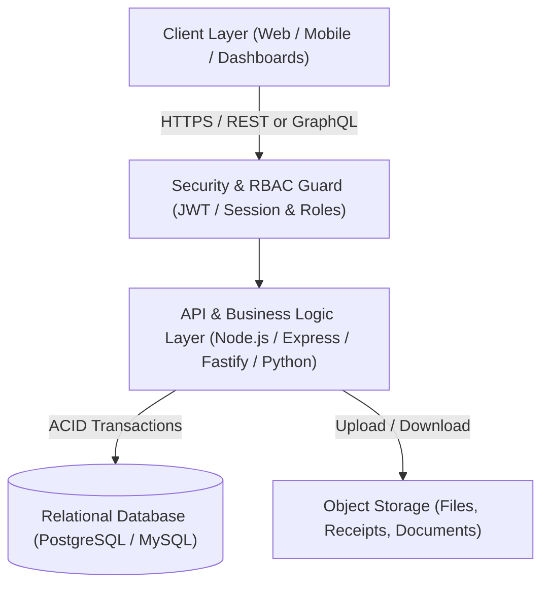
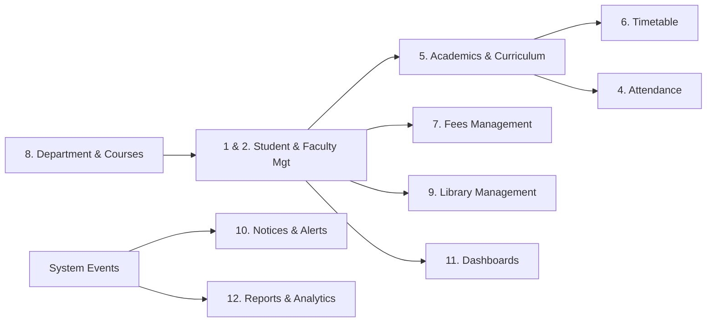

# College ERP Management System: Master Architecture & Development Roadmap

Welcome to the engineering blueprint for your College ERP (Enterprise Resource Planning) system. As your senior software architect and development mentor, this document will serve as our single source of truth throughout the lifecycle of this project.

---

## 1. Architectural Foundation & Core Concepts

An ERP is fundamentally different from a simple blog or e-commerce website. In an ERP, **everything is interconnected**:
- A **Student** belongs to a **Department**.
- A **Class** has a **Timetable** assigned to a **Faculty** member in a specific **Room**.
- An **Attendance** record links a specific Student, Faculty, Subject, and Date.
- A **Fee** payment maps to a specific Student ledger and academic session.

Because data integrity is critical (a bug cannot be allowed to delete a student's grades or duplicate a fee receipt), we follow industry-standard engineering principles.

### Key Technical Decisions Explained in Plain English

#### A. Relational Database (SQL) vs. Non-Relational (NoSQL)
* **Decision**: We will use a **Relational Database** (such as **PostgreSQL** or **MySQL**).
* **Why**: Relational databases enforce strict **Schemas** and **Foreign Keys**. If someone tries to create an attendance record for a student ID that does not exist, the database itself rejects it. They also provide **ACID** (Atomicity, Consistency, Isolation, Durability) guarantees—essential for financial transactions in Fees Management where partial writes could lose money or corrupt balances.

#### B. Role-Based Access Control (RBAC)
* **Decision**: Granular, role-based permission middleware.
* **Why**: We have multiple distinct personas:
  1. `SUPER_ADMIN` (Full system configuration, database backup, audit logs)
  2. `ADMIN` (Academic staff, fee clerks, department heads)
  3. `FACULTY` (Professors, teaching assistants, lab instructors)
  4. `STUDENT` (Enrolled learners)
* Every API endpoint will verify not only *who* is making the request, but *what role* and *what department/section* they belong to.

#### C. Modular Monolith Architecture
* **Decision**: Build as a well-structured **Modular Monolith** first (rather than premature microservices).
* **Why**: Microservices introduce massive operational overhead (network latency, distributed transactions, Docker orchestration, complex deployment). A modular monolith gives clean separation between modules inside one clean codebase, making development fast, maintainable, and beginner-friendly, with the option to split into microservices later if needed.

---

## 2. Comprehensive Module Breakdown

The requirements include 12 key modules (plus a critical missing link we are identifying):

> [!NOTE]
> **Observation on Module #5:** In your requirements list, item #5 was omitted. In an academic institution, the core link between Departments, Students, and Faculty is **Courses, Subjects & Curriculum / Examination**. We have included this as **Module 5: Academics & Examination Management** so our ERP has no missing links.

### Module Specifications

| # | Module | Core Responsibilities |
| :--- | :--- | :--- |
| **1** | **Student Management** | Admissions, student profile, roll number generation, semester promotions, batch/section allocation, status (active, alumni, suspended). |
| **2** | **Faculty Management** | Faculty onboarding, employment details, department mapping, designations, assigned subjects, workload tracking. |
| **3** | **Admin Management** | User credential issuance, permission management, academic calendar configuration, audit trails (who changed what). |
| **4** | **Attendance Management** | Session/lecture-wise attendance marking, daily summaries, percentage calculations, minimum attendance alerts (<75% rules), student leave applications. |
| **5** | **Academics & Examination (Recommended)** | Syllabus, subject codes, credit hours, exam scheduling, marks entry, GPA/CGPA grading calculation, report card generation. |
| **6** | **Timetable Management** | Weekly class schedules, room/lab allocation, conflict detection (preventing double-booking of professors or classrooms). |
| **7** | **Fees Management** | Fee structure configuration by department/semester, invoice generation, online/offline payment logging, receipts, dues tracking, penalty calculations. |
| **8** | **Department Management** | Academic hierarchy: College $\rightarrow$ Departments (e.g., CS, Mechanical, Civil) $\rightarrow$ Programs (B.Tech, M.Tech) $\rightarrow$ Batches $\rightarrow$ Sections. |
| **9** | **Library Management** | Book catalog (ISBN, title, author, category), inventory tracking (total copies vs. issued), checkout/check-in, overdue fine calculation. |
| **10** | **Notices & Announcements** | Notice board with role and department targeting (e.g., "All Students", "Only Faculty", "CS Department only"), file attachments. |
| **11** | **Dashboards (Student & Faculty)** | Personalized views: Student dashboard (attendance gauge, pending fees, upcoming classes, recent notices); Faculty dashboard (today's schedule, pending attendance entry, assigned classes). |
| **12** | **Reports & Analytics** | Defaulter lists (fees and attendance), semester performance analytics, faculty load reports, export to Excel/PDF. |

---

## 3. Phased Step-by-Step Development Roadmap

To ensure a smooth learning curve without feeling overwhelmed, we will construct the system in **6 logical phases**.

### Phase 0: Technology Stack Selection & Architecture Blueprint
- Align on the programming languages and frameworks (Frontend, Backend, Database).
- Establish the development environment, Git version control, and project structure rules.
- Design the High-Level Database Schema (ERD).

### Phase 1: Core Skeleton & Authentication (The "Spine")
- Setup Database connection & Migration system.
- Build the **Department Management** structure (the organizational foundation).
- Implement User Authentication with JWT (JSON Web Tokens) and bcrypt password hashing.
- Build the Role-Based Access Control (RBAC) system for Super Admin, Admin, Faculty, and Student.

### Phase 2: Identity & Entity Management (Students & Faculty)
- Student onboarding, profile management, and batch allocation.
- Faculty directory, profiles, and subject assignments.
- Admin dashboard for user approvals and role updates.

### Phase 3: Daily Academic Operations (Timetable & Attendance)
- Course & Subject cataloging with credit points.
- Timetable scheduling with automatic collision detection.
- Attendance marking engine (single-click bulk student marking for faculty) and student attendance calculation views.

### Phase 4: Administrative & Institutional Services (Fees, Library, Notices)
- Fee structure modeling, payment ledger, invoice generation, and receipt printing.
- Library inventory, book lending lifecycle, and fine collection.
- Notice board broadcast engine with role/department filtering.

### Phase 5: Portals, Dashboards & Analytics
- Dedicated Student Portal UI (responsive, intuitive, self-service).
- Dedicated Faculty Portal UI (grading, attendance, timetable).
- Executive Admin Dashboard with analytics widgets (charts, revenue, attendance averages).
- PDF/CSV report generation engine.

### Phase 6: Quality Assurance, Security Hardening & Deployment
- Input validation and SQL injection / XSS prevention.
- Rate limiting to protect against brute force attacks.
- Automated tests for critical paths (grading formulas, fee balance calculations).
- Production deployment setup (Environment variables, Cloud hosting, SSL, database backups).

---

## 4. Recommended Technology Stacks for Beginners

Here are the two top industry choices suited for beginners learning full-stack development:

### Option A: Modern JavaScript/TypeScript Stack (Highly Recommended)
* **Frontend**: React (Vite) + Tailwind CSS (Fast, modern, clean UI components).
* **Backend**: Node.js + Express.js or NestJS (Single language across frontend and backend; easy to master).
* **Database**: PostgreSQL with Prisma ORM or TypeORM (Prisma generates type-safe database queries and intuitive visual schema migrations).

### Option B: Python Full-Stack (Robust & Structured)
* **Backend**: Python with Django or FastAPI.
* **Frontend**: React or Django Templates with Tailwind CSS.
* **Database**: PostgreSQL.
* *Advantage*: Django includes a built-in admin panel and robust ORM out of the box.

---

## 5. Next Immediate Step

Before any code is written or packages are installed:
1. **Confirm Module 5**: Confirm that adding *Academics & Examination Management* aligns with your vision.
2. **Choose Tech Stack**: Decide between **Option A (JavaScript/TypeScript + React + Node/Express + PostgreSQL)** or **Option B (Python)**, or let me know if you have an alternative preference.
